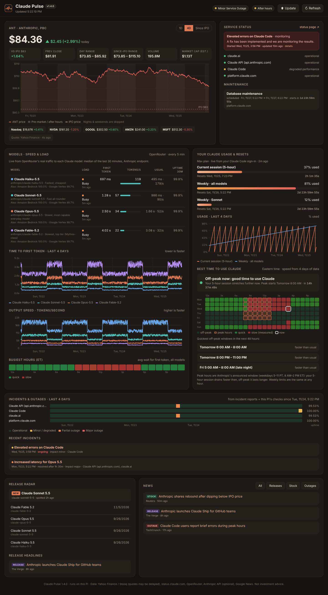

# Claude Pulse

A local dashboard for Anthropic and Claude that runs on a Raspberry Pi 5, any Linux machine, or a **Windows 10/11 PC** (Python 3.9+). It uses only the Python standard library, so there's nothing to `pip install` (on Windows the installer adds the small `tzdata` package, since Windows has no built-in time-zone database).



*(Screenshot uses sample data.)*

**What it shows**

- **ANT stock.** Live quote, the change today and against the $83 IPO price, the day range, volume and an estimated market cap. The chart covers 1 day, 4 days or every day since the IPO, with pre-market and after-hours shaded. It also lists Nasdaq, NVDA, GOOGL, AMZN and MSFT for context.
- **Service status.** Each component on status.claude.com, live incident updates, and scheduled maintenance with countdowns.
- **Incident timeline.** A 4-day outage bar and uptime % for each component, built from incident reports plus the Pi's own checks every 2 minutes.
- **Model speed and load.** Live from OpenRouter's real traffic to each Claude model: uptime with no key, plus time to first token and tokens per second with a free OpenRouter key. Each model is compared with its usual speed and labeled Faster than usual, Normal, Busy or Very busy. Includes 4-day charts and a "busiest hours" heatmap.
- **Your usage and resets.** Live 5-hour session and weekly usage with reset countdowns and a 4-day chart, read automatically through Claude Code's sign-in on the Pi. API rate-limit headroom appears too if you add an Anthropic API key.
- **Best time to use Claude.** Shows whether it's peak or off-peak right now with a countdown, a week grid (Eastern time) of Anthropic's peak window combined with the speed this Pi has measured, and the quickest off-peak windows in the next 48 hours.
- **Release radar.** Checks the Claude model list every hour (OpenRouter's public list, or Anthropic's with a key) and flags any new model, plus headlines about releases.
- **News.** Headlines from the last week, filterable by Releases, Stock and Outages.

## Install on a Raspberry Pi / Linux (one line)

Open a terminal on the Pi and paste:

```bash
curl -fsSL https://raw.githubusercontent.com/hardwaremack-prog/claude-pulse/main/get.sh | bash
```

To **update**, press the **⬆ Update** button at the top of the dashboard. It turns orange when a new version is on GitHub, installs it, restarts the app and reloads the page. Running the same line again works too. Either way, your settings and history are kept.

Or install from a clone:

```bash
git clone https://github.com/hardwaremack-prog/claude-pulse.git && cd claude-pulse && ./install.sh
```

The installer:

- copies the app to `~/claude-pulse`
- sets up a background service (`claude-pulse`) that starts on boot
- puts a **Claude Pulse icon on your desktop** and in the app menu (Internet section)
- optionally asks for a free OpenRouter key and an Anthropic API key (both can be skipped)

Then double-click the desktop icon, or browse to `http://localhost:8787`. Other devices on your network can use `http://<pi-ip>:8787`.

## Install on Windows (one line)

Open **PowerShell** (Start menu → type "PowerShell") and paste:

```powershell
irm https://raw.githubusercontent.com/hardwaremack-prog/claude-pulse/main/windows/get.ps1 | iex
```

The installer:

- installs Python 3.12 for your user account if you don't have it (through winget, no admin needed)
- copies the app to `%LOCALAPPDATA%\ClaudePulse`
- puts a **Claude Pulse icon on your desktop** and in the Start menu
- starts the data collector quietly in the background at every sign-in, with no window
- optionally asks for a free OpenRouter key and an Anthropic API key (both can be skipped)

Double-click the desktop icon to open the dashboard in its own window. Updates work the same as on the Pi: press **⬆ Update** at the top, or run the line again.

Prefer not to paste a command? Download the repo as a ZIP (green **Code** button → **Download ZIP**), unzip it, open the `windows` folder and double-click **install.cmd**.

On Windows the dashboard is only reachable from the PC itself (`"bind": "127.0.0.1"`), so there's no firewall prompt. Settings live in `%APPDATA%\ClaudePulse\config.json`, history and the log in `%LOCALAPPDATA%\ClaudePulse\data`.

For automatic plan usage on Windows, install Claude Code in PowerShell with `irm https://claude.ai/install.ps1 | iex`, then run `claude` once and sign in.

To uninstall: `powershell -ExecutionPolicy Bypass -File "%LOCALAPPDATA%\ClaudePulse\app\uninstall.ps1"` (add `-Purge` to delete settings and history too).

## Model speed: free OpenRouter key (recommended)

Without any key, the dashboard already shows each Claude model's live uptime from OpenRouter.

For speed numbers (time to first token and tokens/second):

1. Sign in at https://openrouter.ai/settings/keys and click **Create Key**. It's free, and reading these stats needs no credits.
2. Paste it when the installer asks, or put it in `~/.config/claude-pulse/config.json` as `"openrouter_api_key": "sk-or-..."`.
3. That's it: changes to the config are picked up within a minute.

The app picks the newest Haiku, Sonnet, Opus and Fable/Mythos models automatically. To choose them yourself, list OpenRouter model ids in `openrouter_models`.

## Anthropic API key (optional extras)

An Anthropic key (console.anthropic.com) adds:

- your own **API rate-limit** headroom
- **instant new-model alerts** from Anthropic's own model list
- your own speed probes, if you want them alongside OpenRouter's numbers

Put it in the config as `"anthropic_api_key"`. The probes send each model a tiny request every `probe_interval_min` minutes (default 15), about a cent a day. The speed table uses OpenRouter's numbers when it has them, and your probes otherwise.

## Your plan usage (automatic, through Claude Code)

Claude has no official API for plan usage. Claude Pulse reads it the way Claude Code does:

1. Install Claude Code on the Pi: `curl -fsSL https://claude.ai/install.sh | bash`
2. Run `claude` once and sign in with your Claude account.

That's all. Every 5 minutes the dashboard reads the sign-in Claude Code saved in `~/.claude/.credentials.json` and fetches your session and weekly usage, with reset times. The token stays on the Pi: it's only sent to Anthropic, never to the web page.

- This uses an **undocumented** endpoint, so Anthropic could change it at any time. If it stops working, the card falls back to typing the numbers in by hand (**Update** button, numbers from Claude → Settings → Usage).
- If the card says the sign-in has **expired**, run `claude` once in a terminal on the Pi to refresh it.
- To turn this off, set `"claude_usage_auto": false` in the config.

## Peak hours

Anthropic's announced peak window is weekdays 5–11 AM Pacific (8 AM–2 PM Eastern). During it, your 5-hour session drains faster; off-peak it lasts longer. Weekly limits are the same at any hour. If Anthropic changes the window, edit `peak_hours` in the config:

```json
"peak_hours": {"tz": "America/Los_Angeles", "days": [0, 1, 2, 3, 4], "start_hour": 5, "end_hour": 11}
```

`days` counts Monday as 0. The speed colors in the week grid come from the data this Pi collects, so they get more accurate over the first week.

## Handy commands

```bash
systemctl status claude-pulse          # is it running?
journalctl -u claude-pulse -f          # live log
sudo systemctl restart claude-pulse    # restart (config edits are picked up automatically)
./uninstall.sh                         # remove (add --purge to delete history + config)
```

To change the port, set `"port"` in the config and re-run `./install.sh`, so the desktop icon points to the new port.

## Data sources and limits

- **Quotes:** Yahoo Finance's public chart endpoint, falling back to Nasdaq.com's quote API and then Stooq. Quotes can be delayed and this isn't investment advice.
- **Market hours:** The app knows the 2026–2027 Nasdaq holidays and early closes.
- **Status:** status.claude.com's public Statuspage API, falling back to status.anthropic.com.
- **Model speed and uptime:** OpenRouter's public endpoint stats (30-minute medians).
- **News:** Google News RSS.
- **History:** stored in `~/.local/share/claude-pulse/pulse.db` (SQLite) and kept for 45 days. The 4-day charts for speed and the Pi's own status checks fill in as the app runs. Stock history and incident reports are available right away.
